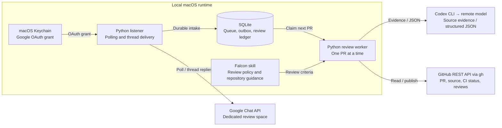

# Launch Engineering Review Agent

Automated pull request reviews requested through a dedicated Google Chat space. The agent acknowledges a request, reviews a captured commit using Falcon criteria, submits an approval or request for changes on GitHub, and reports the outcome in the original Chat thread.

The service runs locally on macOS. A lightweight Python listener handles intake independently of one sequential review worker, so incoming requests can be acknowledged while another review is running. Model inference runs remotely through the authenticated Codex CLI; idle polling does not invoke a model.

## Using the agent

Post a GitHub pull request URL in the [review space](https://chat.google.com/u/0/app/chat/AAQAixK3auw). A tag is not required in this dedicated space, and teammates do not need to authorize the agent individually.

```text
https://github.com/ROKT/launch-engineering/pull/1234
```

| Reaction | Meaning | Thread response |
| --- | --- | --- |
| 👀 | Request received and queued | Acknowledgment; duplicate requests reference the original request time. |
| ✅ | Approved | Review summary, GitHub review link, and commit SHA. |
| 💬 | Changes requested | Explanation, GitHub review link, and commit SHA. |
| ⚠️ | Review held or skipped | Reason and, where applicable, the next action. |

Reactions are additive: 👀 remains as the receipt. The latest thread response explains the current state. Reposting the same reviewed commit reuses the existing result without another model review. A new commit can receive a fresh review.

Current scope is `ROKT/launch-engineering`, including `Orbit/`. Reviews are submitted as `justinlee1253`. Requests from the operator's own Chat identity, bot messages, and PRs authored by either configured operator GitHub identity are excluded. This deployment is deliberately scoped; cloning it does not provision another identity or authorize additional repositories.

### STAMP exception

Only users with explicit STAMP permission may request an approval without code review. Contact Justin Lee at [justin.lee@rokt.com](mailto:justin.lee@rokt.com) to request access. Permission is checked against the sender's verified Google Chat identity; the current implementation authorizes `mani.vedma@rokt.com`.

Authorized users can request:

```text
https://github.com/ROKT/launch-engineering/pull/1234 STAMP
```

STAMP submits an approval **without code review** and says so explicitly on GitHub and in the Chat thread. It never merges. The sender must be verified from Google-provided identity fields; a name or email pasted into a message cannot authorize this action. Repository, PR state, CI, duplicate, account, and current-head checks still apply. A moved head requires a new explicit STAMP request. Repository folder URLs cannot identify a PR.

**The PR creator retains full ownership and responsibility for any stamped PR**, including its correctness, security, testing, and production impact. A STAMP approval does not transfer that responsibility to the agent or the person requesting the stamp.

## Architecture



[Interactive architecture diagram](docs/diagrams/architecture.html) · [Mermaid source](docs/diagrams/architecture.mmd)

The interactive diagram is a standalone HTML file; download it and open it in a browser. Its evidence links identify the inspected source revision. The diagram shows component boundaries, not deployment readiness.

### Request lifecycle

1. **Receive.** The listener polls only the configured space every two seconds on a healthy connection. It persists eligible requests and queues the acknowledgment and 👀 reaction before advancing the scan checkpoint.
2. **Schedule.** A SQLite queue selects requests in original posting order. One worker processes a PR at a time; the listener continues receiving requests. Reposts attach to active work instead of creating another review.
3. **Check eligibility.** The worker verifies the GitHub account, PR state, existing reviews, and CI status before spending model tokens. Pending CI waits; failed CI, drafts, merged/closed PRs, and conflicts produce a held result.
4. **Collect evidence.** GitHub REST reads retrieve complete text changes and relevant files at captured commit SHAs. The worker includes repository instructions, local architecture context, Falcon criteria, and the review policy. Additional evidence requests are restricted to approved files and directories.
5. **Review.** The Codex subprocess returns structured findings or requests for more evidence. The host validates completeness and file/line references. Missing required context cannot produce an approval.
6. **Publish.** The host rechecks account, head, PR state, CI, and intervening manual decisions, then reserves and submits one commit-anchored GitHub review. It queues the verdict and reaction for delivery to the original Chat thread.

The model cannot publish directly. Shell, browser, plugins, MCP connections, hooks, and agent tools are disabled in the review subprocess. Python owns all validated evidence reads and external writes. Google Chat uses the REST API directly; GitHub REST requests use `gh api`. Neither Chat MCP nor GitHub MCP is required by this runtime.

## Review policy

Reviews prioritize material correctness bugs, vulnerabilities, broken contracts, data loss, reliability failures, and consequential design flaws. Formatting preferences, naming tastes, speculative rewrites, and missing tests alone do not block a merge. A complete review with no material blockers approves; substantiated blockers request changes.

The review inputs are:

- The installed Falcon skill, currently loaded from `~/.codex/skills/avengers-falcon/SKILL.md`.
- The agent-specific [review policy](review-policy.md), which defines automation permissions and overrides interactive skill behavior.
- Repository guidance and source evidence at captured SHAs, plus required local architecture references.

The configured model is GPT-6.1 Sol with Fast service and `xhigh` reasoning. Settings and reference credit rates live in [usage.py](usage.py). All review lenses run sequentially.

## Setup

### Install dependencies

```bash
python3 -m venv .venv
.venv/bin/python -m pip install -r requirements.lock
```

### Authorize Google and verify renewal

On a fresh installation, use the downloaded Desktop OAuth client file:

```bash
.venv/bin/python auth.py authorize --client-file /absolute/path/to/client.json
.venv/bin/python auth.py check --force-refresh
```

The supported Google OAuth library requests offline access and verifies that a refresh token was issued. The grant is stored in macOS Keychain. Background operation renews access tokens silently and never opens an authorization browser.

Required scopes:

```text
https://www.googleapis.com/auth/chat.messages.readonly
https://www.googleapis.com/auth/chat.messages.create
https://www.googleapis.com/auth/chat.messages.reactions.create
```

An existing grant should be checked rather than authorized again. Revocation or policy changes can still invalidate authorization; the runtime pauses and records the failure rather than repeatedly prompting. Keep OAuth client files and grants out of Git, Chat messages, and logs.

### Configure and start

```bash
.venv/bin/python agent.py configure --space https://chat.google.com/u/0/app/chat/AAQAixK3auw
.venv/bin/python agent.py check-chat
.venv/bin/python agent.py run
```

Configuration records an activation timestamp and refuses to overwrite existing state. Older messages are excluded. Runtime files are created under `.runtime/`, which is excluded from Git. Stop the foreground process with Ctrl-C.

Polling and reaction settings live in `.runtime/config.json`. The current supported polling interval is two seconds. The reaction mapping is:

```json
{
  "picked_up": "👀",
  "approved": "✅",
  "changes_requested": "💬",
  "warning": "⚠️"
}
```

These keys belong under `reactions`. Preserve the configured space, activation timestamp, and database when changing presentation settings. Restart the process after editing configuration.

### Enable login startup

After a real pilot request has completed successfully, stop the foreground process and install the macOS LaunchAgent:

```bash
.venv/bin/python launch_agent.py render
.venv/bin/python launch_agent.py install
.venv/bin/python launch_agent.py status
```

The installer requires verified Google renewal and a submitted pilot review in the local ledger. It installs one login service with a process lock, background scheduling, and restart throttling. It runs while the Mac is awake and does not keep the computer awake. Pushing this repository to GitHub does not deploy or start the service.

## Operations

| Command | Purpose |
| --- | --- |
| `.venv/bin/python agent.py status` | Scan checkpoint, queue counts, delivery state, and authentication health. |
| `.venv/bin/python agent.py history` | Request outcomes, review IDs/URLs, captured SHAs, and recent events. |
| `.venv/bin/python agent.py costs` | Model token usage and reference credit estimates, including failed runs where reported. |
| `.venv/bin/python auth.py status` | Non-secret Google authorization health. |
| `.venv/bin/python launch_agent.py stop` | Unload the login service. |

Cost records distinguish measured token usage from estimates. Unreported usage remains unknown; it is not recorded as zero. Reference credit estimates are not invoices or account-specific dollar charges.

### Holds and recovery

| Condition | Behavior |
| --- | --- |
| CI still running | Waits and checks again before starting analysis. |
| Failed/cancelled CI, draft, conflicts, empty diff, merged/closed PR | Holds or skips; thread explains the reason. |
| Head/base changes during review | Cancels obsolete work and queues a fresh review after a stability delay; repeated changes hold for attention. |
| Head changes during submission | Records the submitted review against its old commit and marks it stale. |
| Existing review of the same head | Reuses the result and links it; no additional review. |
| Intervening manual review or blocking decision | Holds for operator attention. |
| Incomplete evidence, model failure, wrong account, or inaccessible repository | Holds; never converts missing evidence into approval. |
| Uncertain GitHub write response | Reconciles author, head, event, and stable marker against the review timeline; never blindly repeats the write. |
| Google authorization failure | Durably pauses Chat access; no repeated consent prompts. |

After repairing a Chat connection, verify and explicitly resume:

```bash
.venv/bin/python agent.py check-chat --resume
```

Only a genuinely invalid Google grant requires explicit repair with `auth.py authorize --client-file ... --reauthorize`, followed by renewal verification. After investigating a held review, an operator can use `agent.py retry JOB_ID`. Reserved writes receive reconciliation only. STAMP requests without a reserved write require a fresh request from Mani.

### Local data

`.runtime/state.sqlite3` stores queue state, message resource IDs/timestamps/threads, outgoing replies, review intents, usage, and the review ledger. Incoming message bodies are not retained. `.runtime/payloads/` contains outgoing GitHub review payloads. `.runtime/activity.log` rotates at 1 MB with three backups. The runtime directory is owner-only; credentials remain in Keychain or the respective CLI's authentication storage.

Preserve the SQLite database and its WAL files together when backing up. Deleting state can lose pending work and deduplication history. A failed Chat delivery does not repeat a successful GitHub review.

## Development

| File | Responsibility |
| --- | --- |
| [agent.py](agent.py) | Space-scoped intake, durable queue/outbox, reactions, supervision, operator CLI. |
| [auth.py](auth.py) | Explicit Google authorization, Keychain storage, silent renewal, and pause behavior. |
| [review.py](review.py) | Fixed-commit evidence, bounded model analysis, validation, and GitHub publishing. |
| [review-policy.md](review-policy.md), [review.schema.json](review.schema.json) | Review instructions and structured result contract. |
| [usage.py](usage.py) | Model settings, reported token accounting, and reference credit estimates. |
| [launch_agent.py](launch_agent.py) | Login service definition and controlled installation. |

Run the focused local checks:

```bash
.venv/bin/python -m unittest discover -v
```

The suite uses fixtures for authorization, queue recovery, deduplication, evidence validation, changed heads, ambiguous writes, and listener responsiveness. It does not execute code from reviewed PRs. Reviews also do not run repository builds or test suites; GitHub review text states this limitation.

The text-review limits are 150 changed files, 250 KB per file, 1.2 million serialized context characters, up to eight evidence rounds, and ten minutes per model invocation. Binary files, symlinks, submodules, inaccessible required context, and exceeded limits hold for manual attention. A GitHub review is anchored to a commit; the API does not provide an atomic guarantee that it remains the latest head.

Deployment acceptance must include a real threaded acknowledgment, the correct GitHub review identity, same-head deduplication, restart recovery, and silent token renewal. Unit tests and initial login alone do not establish live readiness.
