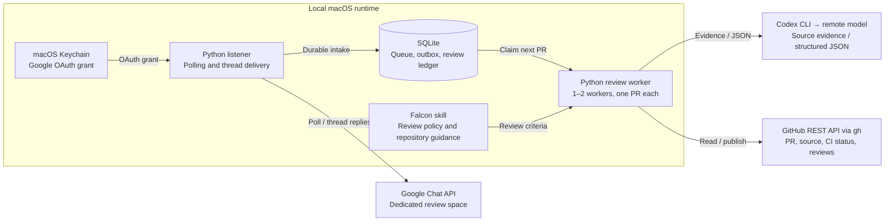

# Launch Engineering Review Agent

Automated pull request reviews requested through a dedicated Google Chat space. The agent acknowledges a request, reviews a captured commit using Falcon criteria, submits an approval or request for changes on GitHub, and reports the outcome in the original Chat thread.

The service runs locally on macOS. A lightweight Python listener handles intake independently of one or two isolated review workers, so incoming requests can be acknowledged while another review is running. Model inference runs remotely through the authenticated Codex CLI; idle polling does not invoke a model.

## Using the agent

Post a GitHub pull request URL in the [review space](https://chat.google.com/u/0/app/chat/AAQAixK3auw). A tag is not required in this dedicated space, and teammates do not need to authorize the agent individually.

```text
https://github.com/ROKT/launch-engineering/pull/1234
```

| Reaction | Meaning | Thread response |
| --- | --- | --- |
| 👀 | Request received and queued | Acknowledgment; duplicate requests reference the original request time. |
| ✅ | Approved | Review summary, GitHub review link, and commit SHA. |
| 💬 | Changes requested | Explanation, GitHub review link, and commit SHA. |
| ⚠️ | Review held or skipped | Reason and, where applicable, the next action. |

Every PR request message, including thread replies, has one current agent status. Status updates remove the agent's previous status before adding the new one; other people's reactions are preserved. Google exposes separate delete/create calls, so a transition can briefly show no status. Reposting the same reviewed commit reuses the existing result without another model review. A new commit can receive a fresh review.

Current scope is `ROKT/launch-engineering`, including `Orbit/`. Reviews are submitted as `justinlee1253`. Everyone in the designated space, including the operator, can request a review. The agent ignores its own outgoing replies and bot messages; PRs authored by either configured operator GitHub identity remain excluded. This deployment is deliberately scoped; cloning it does not provision another identity or authorize additional repositories.

### STAMP exception

Only users with explicit STAMP permission may request an approval without code review. Contact Justin Lee at [justin.lee@rokt.com](mailto:justin.lee@rokt.com) to request access. Permission is checked against the sender's verified Google Chat identity.

Authorized users can request:

```text
https://github.com/ROKT/launch-engineering/pull/1234 STAMP
```

STAMP submits an approval **without code review** and says so explicitly on GitHub and in the Chat thread. It never merges. The sender must be verified from Google-provided identity fields; a name or email pasted into a message cannot authorize this action. Repository, PR state, CI, duplicate, account, and current-head checks still apply. A moved head requires a new explicit STAMP request. Repository folder URLs cannot identify a PR.

**The PR creator retains full ownership and responsibility for any stamped PR**, including its correctness, security, testing, and production impact. A STAMP approval does not transfer that responsibility to the agent or the person requesting the stamp.

STAMP access is managed in the local `.runtime/stamp-permissions.json` file:

```json
{
  "allowed_emails": [
    "authorized.teammate@rokt.com",
    "another.authorized.teammate@rokt.com"
  ]
}
```

Add or remove exact email addresses to grant or revoke access; matching is case-insensitive. The file is reloaded when checking a request and immediately before submitting an approval, so allowlist edits do not require a restart. Verified sender IDs are cached separately and never override the current allowlist. A missing or empty file grants nobody access; invalid JSON prevents stamping. Copy [stamp-permissions.example.json](stamp-permissions.example.json) to the local runtime directory for a new installation. The active allowlist is excluded from Git and is never read from PR or Chat content.

## Architecture



[Interactive architecture diagram](docs/diagrams/architecture.html) · [Mermaid source](docs/diagrams/architecture.mmd)

The interactive diagram is a standalone HTML file; download it and open it in a browser. Its evidence links identify the inspected source revision. The diagram shows component boundaries, not deployment readiness.

### Request lifecycle

1. **Receive.** The listener polls only the configured space every two seconds on a healthy connection. It persists eligible requests and queues the acknowledgment and 👀 reaction before advancing the scan checkpoint.
2. **Schedule.** A SQLite queue selects requests in original posting order. Each worker processes one PR at a time; the listener continues receiving requests. Reposts attach to active work instead of creating another review.
3. **Check eligibility.** The worker verifies the GitHub account, PR state, existing reviews, and CI status before spending model tokens. Pending CI waits; failed CI, drafts, merged/closed PRs, and conflicts produce a held result.
4. **Collect evidence.** GitHub REST reads retrieve complete text changes and relevant files at captured commit SHAs. The worker includes repository instructions, local architecture context, Falcon criteria, and the review policy. Additional evidence requests are restricted to approved files and directories.
5. **Review.** The Codex subprocess returns structured findings or requests for more evidence. Absent supplemental files/directories are reported back to the reviewer so it can continue or explain a material evidence gap. The host saves the original draft and captured evidence before validating completeness and file/line references. A unique exact quotation can correct its own line number; other citation mismatches get at most one citation-only model pass, bounded to two minutes. Corrections cannot remove findings or change their meaning, blocking labels, or severity. Remaining mismatches hold the review with the exact finding, path, side, and line. Missing changed-file source or genuinely required context cannot produce an approval.
6. **Publish.** The host rechecks account, head, PR state, CI, and intervening manual decisions, then reserves and submits one commit-anchored GitHub review. It queues the verdict and reaction for delivery to the original Chat thread.

The model cannot publish directly. Shell, browser, plugins, MCP connections, hooks, and agent tools are disabled in the review subprocess. Python owns all validated evidence reads and external writes. Google Chat uses the REST API directly; GitHub REST requests use `gh api`. Neither Chat MCP nor GitHub MCP is required by this runtime.

Each review attempt has one **20-minute overall budget**, starting when the worker begins the PR. Preflight, evidence capture, every model round, citation correction, and checks before publication share the same deadline. A model call can use all remaining time; it has no separate ten-minute cutoff. Citation correction still has its own two-minute maximum within that remaining time. Queue waiting and deferred CI waiting do not consume an attempt's budget.

After expiry, the request is held and no new review write starts. Any completed draft remains available. A GitHub write already attempted is still reconciled and recorded, even after the deadline, so an uncertain result cannot cause a duplicate write. Chat delivery remains in the durable outbox. Shutdown reports `Worker stopped`; model timeouts have separate diagnostics and a `timed_out` usage status.

## Review policy

Chat receipts and start updates use short Orbit/launch-themed wording, the number of earlier reviews, and one approximate finish time. Duplicate requests link to the original thread and reuse existing work. Warning messages state the next action and whether it belongs to the requester, an automatic recheck, or the agent maintainer. Maintainer-only failures use a real Justin mention and a short run reference; repeated unchanged warnings reuse the durable outbox entry.

Completed results retain a substantive overview and every finding and required action, grouped into blockers and non-blocking concerns. GitHub uses readable When/Impact/Fix paragraphs inline, or in the review body when a finding cannot attach to a diff line. Reviewed SHAs, citation checks, validation limits and hidden reconciliation markers remain intact. Long Chat results split into durable numbered replies rather than dropping findings to fit the transport limit.

Reviews prioritize material correctness bugs, vulnerabilities, broken contracts, data loss, reliability failures, and consequential design flaws. Formatting preferences, naming tastes, speculative rewrites, and missing tests alone do not block a merge. A complete review with no material blockers approves; substantiated blockers request changes.

The review inputs are:

- The installed Falcon skill, currently loaded from `~/.codex/skills/avengers-falcon/SKILL.md`.
- The agent-specific [review policy](review-policy.md), which defines automation permissions and overrides interactive skill behavior.
- Repository guidance and source evidence at captured SHAs, plus required local architecture references.

The configured model is GPT-6.1 Sol with Fast service and `xhigh` reasoning. Settings and reference credit rates live in [usage.py](usage.py). All review lenses run sequentially.

Orbit guidance is selected only for changes under `Orbit/` (including previous paths on
renames and removed files), or changed configuration/command lines in shared infrastructure
that explicitly reference `Orbit/`. Unrelated services receive no Orbit vault context.
The host embeds the existing Falcon Orbit reference as text; it does not fork or modify
the skill. Repository rules remain anchored to the PR's captured commits.

Orbit reviews receive the vault entry points, status/open questions, and relevant sections
of the architecture page. Source changes may also load the connector README; UI changes
load available product/design guidance. The model can request specific additional repository
files or a page from the fixed local topic allowlist. Missing required context holds the
review. Local summaries record their compiled SHA against pinned main and remain discovery
context, not proof that a proposal is merged or deployed.

A necessary companion PR can be read with `ref=pr/NUMBER`; its head is pinned and its
merged/proposed/closed state is explicit. A changed dependency prevents publishing a verdict
based on obsolete evidence. The repository allowlist and publishing permissions stay the same.
`.runtime/context/` retains an atomic audit per job/head with inspected document paths,
SHAs, local content hashes and selected guidance. It contains no source-document bodies or
incoming Chat messages.

## Setup

### Install dependencies

```bash
python3 -m venv .venv
.venv/bin/python -m pip install -r requirements.lock
```

### Authorize Google and verify renewal

On a fresh installation, use the downloaded Desktop OAuth client file:

```bash
.venv/bin/python auth.py authorize --client-file /absolute/path/to/client.json
.venv/bin/python auth.py check --force-refresh
```

The supported Google OAuth library requests offline access and verifies that a refresh token was issued. The grant is stored in macOS Keychain. Background operation renews access tokens silently and never opens an authorization browser.

Required scopes:

```text
https://www.googleapis.com/auth/chat.messages.readonly
https://www.googleapis.com/auth/chat.messages.create
https://www.googleapis.com/auth/chat.messages.reactions.create
```

An existing grant should be checked rather than authorized again. Revocation or policy changes can still invalidate authorization; the runtime pauses and records the failure rather than repeatedly prompting. Keep OAuth client files and grants out of Git, Chat messages, and logs.

Replacing a status also requires `https://www.googleapis.com/auth/chat.messages.reactions`.
The older create-only grant remains valid for reads and messages. After explicitly approving
this new capability, upgrade once using the client already in Keychain:

```bash
.venv/bin/python auth.py authorize --reaction-updates
```

This command requests read/create-message access plus full reaction access, opens one Google
consent window, verifies offline refresh, and only then replaces the saved grant. It does not
need another client JSON download. A declined or failed upgrade retains the local prior grant.
The listener never starts this command or opens a permission window on its own. Without delete
permission, it records one delivery failure rather than adding a conflicting second status.

### Configure and start

```bash
.venv/bin/python agent.py configure --space https://chat.google.com/u/0/app/chat/AAQAixK3auw
.venv/bin/python agent.py check-chat
.venv/bin/python agent.py run
```

Configuration records an activation timestamp and refuses to overwrite existing state. Older messages are excluded. Runtime files are created under `.runtime/`, which is excluded from Git. Stop the foreground process with Ctrl-C.

Polling and reaction settings live in `.runtime/config.json`. The current supported polling interval is two seconds. The reaction mapping is:

```json
{
  "picked_up": "👀",
  "approved": "✅",
  "changes_requested": "💬",
  "warning": "⚠️"
}
```

These keys belong under `reactions`. Preserve the configured space, activation timestamp, and database when changing presentation settings. Restart the process after editing configuration.

### Enable login startup

After a real pilot request has completed successfully, stop the foreground process and install the macOS LaunchAgent:

```bash
.venv/bin/python launch_agent.py render
.venv/bin/python launch_agent.py install
.venv/bin/python launch_agent.py status
```

The installer requires verified Google renewal and a submitted pilot review in the local ledger. It installs one login service with a process lock, background scheduling, and restart throttling. It runs while the Mac is awake and does not keep the computer awake. Pushing this repository to GitHub does not deploy or start the service.

## Operations

| Command | Purpose |
| --- | --- |
| `.venv/bin/python agent.py status` | Scan checkpoint, queue counts, delivery state, and authentication health. |
| `.venv/bin/python agent.py history` | Request outcomes, review IDs/URLs, captured SHAs, and recent events. |
| `.venv/bin/python agent.py costs` | Model token usage and reference credit estimates, including failed runs where reported. |
| `.venv/bin/python auth.py status` | Non-secret Google authorization health. |
| `.venv/bin/python launch_agent.py stop` | Unload the login service. |

Cost records distinguish measured token usage from estimates. Unreported usage remains unknown; it is not recorded as zero. Reference credit estimates are not invoices or account-specific dollar charges.

### Holds and recovery

| Condition | Behavior |
| --- | --- |
| CI still running | Waits and checks again before starting analysis. |
| Failed/cancelled CI, draft, conflicts, empty diff, merged/closed PR | Holds or skips; thread explains the reason. |
| Head/base changes during review | Cancels obsolete work and queues a fresh review after a stability delay; repeated changes hold for attention. |
| Head changes during submission | Records the submitted review against its old commit and marks it stale. |
| Existing review of the same head | Reuses the result and links it; no additional review. |
| Intervening manual review or blocking decision | Holds for operator attention. |
| Incomplete evidence, model failure, wrong account, or inaccessible repository | Holds; never converts missing evidence into approval. |
| Uncertain GitHub write response | Reconciles author, head, event, and stable marker against the review timeline; never blindly repeats the write. |
| Google authorization failure | Durably pauses Chat access; no repeated consent prompts. |

After repairing a Chat connection, verify and explicitly resume:

```bash
.venv/bin/python agent.py check-chat --resume
```

Only a genuinely invalid Google grant requires explicit repair with `auth.py authorize --client-file ... --reauthorize`, followed by renewal verification. After investigating a held review, an operator can use `agent.py retry JOB_ID`. Reserved writes receive reconciliation only. STAMP requests without a reserved write require a fresh request from an authorized sender.

Retries and reposts at the same head/base reuse a retained completed draft, including its consumed correction budget, across restarts. A new head/base requires fresh evidence and analysis. Account, CI, dependency, manual-review, and duplicate checks still apply. Resuming a review restores 👀 on all tracked messages for that PR; the final status replaces it.

### Local data

`.runtime/state.sqlite3` stores queue state, message resource IDs/timestamps/threads, outgoing replies, review intents, usage, and the review ledger. Incoming message bodies are not retained. `.runtime/payloads/` contains outgoing GitHub review payloads. `.runtime/activity.log` rotates at 1 MB with three backups. The runtime directory is owner-only; credentials remain in Keychain or the respective CLI's authentication storage.

`.runtime/drafts/` stores private JSON snapshots with the original draft, current corrected draft, captured source, exact citation errors, and correction history. Files are written atomically with owner-only permissions and excluded from Git. These snapshots can contain private repository code; retain them with the same care as the source checkout. A corrupt snapshot holds the request instead of silently spending tokens on another full review.

Preserve the SQLite database and its WAL files together when backing up. Deleting state can lose pending work and deduplication history. A failed Chat delivery does not repeat a successful GitHub review.

The rotating activity log includes structured diagnostics for review start/finish, model run start/finish, requested evidence, and failed GitHub requests. Entries identify the job, PR, captured SHAs, stage, model run ID and elapsed milliseconds when available. GitHub failures include a diagnostic ID, method, known endpoint without query parameters, HTTP status, CLI exit code, response byte counts and a fixed error category. Blob/tree failures identify the requested source path and captured ref where available. Review failures include stack frame locations without exception text or source lines.

Model runs record the CLI version, model settings, evidence round, prompt bytes, document count and bytes, ten largest source documents by size, diff bytes, reported token usage, output bytes, stdout/stderr byte counts and terminal event type. Failures distinguish process exit, cancellation, timeout, missing/oversized output, malformed JSON (with line/column), and unexpected tool items. Recognized provider codes, HTTP status and `req_` request IDs are retained when available; categories distinguish context, schema, configuration, model availability, authentication, rate limits and transport errors. Byte counts are measurements, not token estimates. Chat warnings preserve the failed operation and diagnostic ID instead of guessing that login or usage is the cause. Search `.runtime/activity.log*` for that ID to connect the warning to its model run or GitHub failure.

Successful polls and GitHub reads stay quiet. Diagnostics never retain raw stderr, response bodies, headers, credentials, prompts, source code, findings or private Chat text. Provider error codes are allowlisted; unknown errors remain `unknown` with a SHA-256 fingerprint rather than copying arbitrary provider text into the log. Existing usage accounting stays in SQLite. Inspect diagnostics with `tail -f .runtime/activity.log`; logging does not add retries or relax any publishing checks.

## Development

| File | Responsibility |
| --- | --- |
| [agent.py](agent.py) | Space-scoped intake, durable queue/outbox, reactions, supervision, operator CLI. |
| [auth.py](auth.py) | Explicit Google authorization, Keychain storage, silent renewal, and pause behavior. |
| [review.py](review.py) | Fixed-commit evidence, bounded model analysis, validation, and GitHub publishing. |
| [review-policy.md](review-policy.md), [review.schema.json](review.schema.json) | Review instructions and structured result contract. |
| [usage.py](usage.py) | Model settings, reported token accounting, and reference credit estimates. |
| [launch_agent.py](launch_agent.py) | Login service definition and controlled installation. |

Run the focused local checks:

```bash
.venv/bin/python -m unittest discover -v
```

The suite uses fixtures for authorization, queue recovery, deduplication, evidence validation, changed heads, ambiguous writes, and listener responsiveness. It does not execute code from reviewed PRs. Reviews also do not run repository builds or test suites; GitHub review text states this limitation.

The text-review limits are 150 changed files, 250 KB per file, 1.2 million serialized context characters, up to eight evidence rounds, and one shared twenty-minute processing budget. Citation correction may use at most two minutes of the remaining budget. Binary files, symlinks, submodules, inaccessible required context, and exceeded limits hold for manual attention. A GitHub review is anchored to a commit; the API does not provide an atomic guarantee that it remains the latest head.

Deployment acceptance must include a real threaded acknowledgment, the correct GitHub review identity, same-head deduplication, restart recovery, and silent token renewal. Unit tests and initial login alone do not establish live readiness.


## Review worker capacity and safe rollout

`worker_count` in `.runtime/config.json` accepts only the integers `1` and `2`; omitted means `1`. Restart to apply it. One process retains the existing lock, one Chat listener and one sender. Each worker creates its own SQLite connection, GitHub evidence cache and reviewer. Each attempt gets its own **twenty-minute total processing budget**, excluding queue and deferred CI waiting. Evidence collection, every model round, citation correction (at most two minutes within the remaining budget), and final publication checks share that deadline. Increasing capacity does not change model settings or per-PR criteria.

SQLite claims use `BEGIN IMMEDIATE` and a unique owned-PR index. Ownership lasts through submission and reconciliation. A timeout or dashboard Stop affects only that request. Reserved writes remain reconciliation-only even if their response is lost or the process restarts; a repost attaches instead of starting another write. Interrupted model runs are held for explicit attention, with any unknown usage retained. Queue estimates use the next available worker and stay provisional; CI and unresolved writes have no invented completion time. Operational status and the dashboard show configured capacity and active workers (`Reviewing: 2/2`).

Messages containing several PRs keep one status: 👀 while any is queued, reviewing, submitting or reconciling; then ⚠️ if any is unresolved; then 💬 if any requested changes; otherwise ✅ for approved outcomes, including reused approvals. History and other people's reactions are preserved.

For deployment, finish active reviews before stopping the old process. Keep the same private runtime directory (database, drafts, outbox and saved authentication), acquire the existing process lock, and run startup recovery once before starting workers. First start with `worker_count: 1`, verify heartbeat, queue/history preservation and one listener, then drain active work again and restart with `worker_count: 2`. Observe genuine eligible requests when available; do not create requests or model spending just to test capacity. Measure process/model-child CPU and RSS and inspect per-PR records with `agent.py costs`. Roll back capacity by draining and restarting with `worker_count: 1`; never delete the queue or ledger. Graceful shutdown retains the process lock until all workers exit.

The existing loopback dashboard is available with `.venv/bin/python dashboard.py`; it reuses the same runtime and exposes explicit remove/stop controls. No new services, dependencies or credentials are required.
